<!-- ================================================================= -->
<!-- TALHA RUSMAN — GITHUB PROFILE IDENTITY                            -->
<!-- AI/ML Engineer | Full-Stack Developer | LLM & Computer Vision     -->
<!-- ================================================================= -->

 

  <!--  -->
  
  
  
  

  

## About Me

I am an **AI/ML Engineer and Full-Stack Developer** in my final year pursuing a **Bachelor of Science in Artificial Intelligence** at **FAST National University of Computer and Emerging Sciences (FAST-NUCES)**, Karachi (Graduation: May 2027).

My engineering work bridges the gap between machine learning research and resilient production software. I specialize in designing and deploying low-latency deep learning pipelines, fine-tuning large language models with parameter-efficient techniques, and architecting full-stack applications with production-grade APIs, authentication, and database schemas.

  

## ✨ Profile Snapshot

| | |
| :--- | :--- |
| 🎓 **Education** | AI @ FAST-NUCES · Class of 2027 |
| 🏛️ **Leadership** | Head, Robotics & Automation Society · Head, AI Grand Prix (PROCOM) |
| 💼 **Experience** | AI/ML Intern @ Bank Alfalah · Full-Stack Developer (Contract) |
| 🤖 **Primary Focus** | LLM Fine-Tuning (LoRA) · Computer Vision (ST-GCN) · AI Gateways |
| 🌐 **Stack** | FastAPI + Next.js + PyTorch + PostgreSQL — production-first |
| 🧩 **Approach** | Local CPU Inference (GGUF/llama.cpp) · RAG · Real-Time WebSockets |
| 📊 **Metrics** | 90+ Lighthouse · ≤35ms CV Latency · 94% ML Accuracy |

 

  

## 🎯 Current Focus

* **Architecting Privacy-Aware AI Gateways**: Deploying local and cloud LLM arbitration, enterprise RAG, and automated NLP entity redaction.
* **Low-Latency Edge & CPU Inference**: Fine-tuning open models (Qwen 2.5 with LoRA on 5K+ samples) and deploying quantized GGUF via `llama.cpp`.
* **Real-Time Computer Vision & Pose Tracking**: Building webcam-driven combat engines using MediaPipe 33-joint extraction and custom ST-GCN at ≤35ms latency.
* **Resilient Full-Stack Systems**: Developing Next.js 14 and FastAPI architectures with Stripe payments, OAuth 2.0, WebSockets, and normalized ACID schemas.

  

## Tech Stack

### 🧠 Artificial Intelligence & Machine Learning

  
  
  
  
  
  
  
  
  
  
  

### 💻 Programming Languages

  
  
  
  
  
  

### 🌐 Full-Stack Web & Backend Engineering

  
  
  
  
  
  
  

### 🗄️ Databases, Cloud & DevOps Infrastructure

  
  
  
  
  
  
  
  
  
  

  

## GitHub Contribution & Activity 

  
Live authentic commit &amp; contribution heatmap via GitHub API

  

 

  
  

  

## Connect & Collaborate

I am always interested in discussing machine learning systems, high-throughput backend architecture, open-source initiatives, or software engineering roles.

  <!--  -->
    
  
  &nbsp;
  
  &nbsp;
  

 

  

